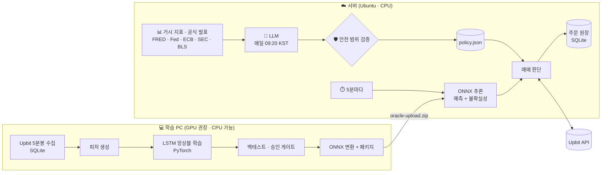

# 📈 Upbit LSTM Trader

**LSTM 앙상블이 5분마다 예측하고, LLM이 매일 시장 환경을 읽어 전략을 조율하는 Upbit 원화마켓 현물 자동매매 시스템**

<br>

[](https://www.python.org/)
[](https://pytorch.org/)
[](https://onnxruntime.ai/)
[](https://www.anthropic.com/)

[](https://numpy.org/)
[](https://pandas.pydata.org/)
[](https://scikit-learn.org/)
[](https://hmmlearn.readthedocs.io/)
[](https://www.sqlite.org/)
[](https://requests.readthedocs.io/)
[](https://pyjwt.readthedocs.io/)
[](https://platform.openai.com/)
[](https://docs.python.org/3/library/tkinter.html)

[](https://docs.upbit.com/)
[](https://fred.stlouisfed.org/)
[](https://www.oracle.com/cloud/free/)
[](https://ubuntu.com/)
[](https://systemd.io/)
[](https://github.com/astral-sh/uv)

[](https://github.com/rottenbutcher/upbit-lstm-trader/actions/workflows/test.yml)
[](https://pytest.org/)
[](https://github.com/astral-sh/ruff)


<br>

[빠른 시작](#-빠른-시작) · [아키텍처](#-아키텍처) · [LLM 정책](#-llm-일일-정책) · [서버 배포](#️-서버-배포) · [안전장치](#️-안전장치) · [문서](#-문서)

<br>

> [!WARNING]
> 이 프로젝트는 연구·학습용입니다. **수익을 보장하지 않으며 실제 손실이 발생할 수 있습니다.** 기본값은 모의매매이고, 저장소에는 미리 학습된 모델이 포함되어 있지 않습니다.

<br>

## ✨ 주요 기능

<table>
<tr>
<td width="50%" valign="top">

### 🧠 LSTM 앙상블 예측
- 거래대금 상위 종목의 5분봉으로 **30분 뒤 수익률** 예측
- 27개 인과적(미래 미참조) 피처: 단기~24시간 수익률, 변동성, 거래량, 요일·시간 주기
- **어텐션 풀링** + 시드가 다른 모델 **앙상블**
- 예측값과 함께 **불확실성**(모델 간 불일치)을 출력

</td>
<td width="50%" valign="top">

### 🤖 LLM 일일 정책
- 거시 지표, 중앙은행·규제기관 발표, 시장 심리를 매일 분석
- 매수 기준, 비중, 손절·익절, 보유 시간을 **자동 조정**
- **검증된 위험 한도보다 위험을 키울 수 없도록** 코드가 강제
- Claude 또는 OpenAI 호환 모델 지원

</td>
</tr>
<tr>
<td width="50%" valign="top">

### 🖥️ 클릭 한 번 학습 GUI
- 프리셋 선택 → 설정 저장 → 학습까지 한 창에서
- 각 설정에 한글 설명, 저장 전 자동 검증
- 실시간 로그와 진행률, 중단 후 이어서 학습

</td>
<td width="50%" valign="top">

### ☁️ 저비용 클라우드 운용
- 학습은 내 PC, 추론은 **무료 클라우드 VM(CPU)**
- systemd 타이머로 5분마다 판단, 재부팅 자동 복구
- 웹 포트 없음, 출금 권한 불필요

</td>
</tr>
</table>

<br>

## 🏗 아키텍처



<br>

## 🚀 빠른 시작

### 1️⃣ 학습 — GUI 방식 (권장)

<table>
<tr><th>Windows</th><th>Linux</th></tr>
<tr>
<td>

```text
GUI.cmd 더블클릭
```

</td>
<td>

```bash
bash scripts/train.sh gui
```

</td>
</tr>
</table>

처음 실행할 때 Python과 학습 라이브러리가 프로젝트 폴더 안에 자동 설치됩니다. 시스템 설정은 건드리지 않습니다.

| 단계 | 할 일 |
|:---:|---|
| **1** | 프리셋을 고르고 `적용`을 누릅니다. `빠른 점검` / `균형 (권장)` / `고성능` 중 선택 |
| **2** | 필요하면 탭별로 값을 조정하고 **`설정 저장`**을 누릅니다 |
| **3** | **`① 데이터 받기 + 학습 + 패키지`**를 누릅니다 |
| **4** | 완료되면 **`결과 보고서 열기`**로 성과를 확인합니다 |

결과물은 서버에 올릴 `dist/oracle-upload.zip`입니다. GPU가 없으면 `GPU 없이(CPU)`를 체크하세요. 학습은 더 오래 걸립니다.

<details>
<summary><b>⌨️ 명령 방식으로 학습하기</b></summary>

<br>

| 작업 | Windows | Linux |
|---|---|---|
| 전체 학습 | `TRAIN.cmd` | `bash scripts/train.sh` |
| 이어서 학습 | `RESUME.cmd` | `bash scripts/train.sh resume` |
| HMM 비교 연구 | `HMM.cmd` | `bash scripts/train.sh hmm` |
| 환경 점검 | — | `bash scripts/train.sh check` |

- 학습이 중단되면 마지막으로 완료된 epoch부터 이어집니다. 앙상블에서 이미 끝난 모델은 건너뜁니다.
- 데이터나 설정을 바꾼 뒤에는 처음부터 다시 학습해야 합니다.
- 재학습 전에 기존 `artifacts` 폴더를 따로 보관하세요.
- 다른 PC로 옮길 때는 `.venv`와 `.tools`를 빼고 **소스 + `data` + `artifacts`**만 복사합니다.

</details>

### 2️⃣ 배포

```text
DEPLOY.cmd 더블클릭 → 서버 IP · SSH 키 경로 입력
```

업로드와 설치가 자동으로 진행되고, **모의매매**가 시작됩니다. 자세한 내용은 [서버 배포](#️-서버-배포)를 보세요.

<br>

## 🤖 LLM 일일 정책

매일 한 번 LLM이 시장 환경을 분석해 다음 날의 매매 파라미터를 정합니다. **LLM은 주문하지 않습니다.** 숫자만 제안하고, 코드가 검증한 값만 반영됩니다.

<table>
<tr>
<td width="50%" valign="top">

**📥 입력 데이터**

| 분류 | 출처 |
|---|---|
| 금리·물가 | 연방기금금리, 미 국채 2·10년물, 기대인플레이션 |
| 위험 지표 | VIX, 하이일드 스프레드, 달러지수, 원/달러 |
| 공식 발표 | Fed · ECB · SEC · BLS 보도자료 |
| 암호화폐 | 공포·탐욕 지수, BTC 점유율 |
| 거래 종목 | Upbit 일봉 추세·변동성 |

</td>
<td width="50%" valign="top">

**📤 조정 파라미터**

| 파라미터 | 허용 범위 |
|---|---|
| 신규 매수 허용 | on / off |
| 매수 기준 | 기준값 × 0.8 ~ 3.0 |
| 종목 비중 · 총 노출 | **기준값 이하만** |
| 손절 · 일일 손실 한도 | **기준값 이하만** |
| 익절 · 보유 시간 | 기준값 × 0.5 ~ 1.5 / 2.0 |
| 불확실성 페널티 | 0 ~ 2 |

</td>
</tr>
</table>

```bash
sudo bash /opt/upbit-lstm/current/deploy/configure-llm.sh   # API 키 등록 + 시험 실행
sudo bash /opt/upbit-lstm/current/deploy/botctl.sh policy-show   # 오늘 적용된 값 확인
```

> [!TIP]
> LLM 설정은 선택 사항입니다. 설정하지 않으면 학습·백테스트로 검증된 기준값으로 동작합니다. LLM 호출이나 데이터 수집이 실패해도 매매는 멈추지 않고, 정책이 만료되면 기준값으로 돌아갑니다.

자세한 내용은 📘 [LLM 정책 문서](docs/LLM_POLICY.md)를 보세요.

<br>

## ☁️ 서버 배포

**Ubuntu 24.04** (ARM64 · AMD64) 서버가 필요합니다. GPU는 필요 없습니다. Oracle Cloud Always Free 인스턴스로도 충분합니다.

<details open>
<summary><b>① 설치 · 모의매매</b></summary>

<br>

`DEPLOY.cmd`를 쓰지 않는 경우, ZIP을 서버에 올린 뒤 다음을 실행합니다.

```bash
sudo apt-get update && sudo apt-get install -y unzip
mkdir -p ~/upbit-release && unzip oracle-upload.zip -d ~/upbit-release
cd ~/upbit-release && sudo bash deploy/install.sh
```

매 5분 경계 + 15초에 실행됩니다. 상태 확인 명령은 다음과 같습니다.

```bash
sudo journalctl -u upbit-lstm.service -f
sudo bash /opt/upbit-lstm/current/deploy/botctl.sh status
```

</details>

<details>
<summary><b>② 실거래 전환</b></summary>

<br>

1. [Upbit Open API](https://upbit.com/mypage/open_api_management)에서 **자산조회 · 주문조회 · 주문하기** 권한의 키를 발급합니다. 출금 권한은 필요 없습니다. 서버 IP를 허용 목록에 등록하세요.
2. 운용 자본(기본 100,000원)은 학습 전에 `config.toml` 또는 GUI의 `승인/자본` 탭에서 정합니다. 실거래도 같은 값을 사용합니다.
3. 보고서가 승인 기준을 통과했다면 다음을 실행합니다.

```bash
sudo bash /opt/upbit-lstm/current/deploy/configure-live.sh
```

기존 보유 코인은 자동으로 매도하지 않습니다. 운용에 포함하려면 수량을 지정해 등록합니다.

```bash
sudo bash /opt/upbit-lstm/current/deploy/botctl.sh adopt --market KRW-BTC --quantity 0.0001 --confirm
```

</details>

<details>
<summary><b>③ 긴급 중지</b></summary>

<br>

```bash
sudo touch /var/lib/upbit-lstm/STOP           # 모든 신규 주문 중지
sudo bash /opt/upbit-lstm/current/deploy/botctl.sh policy-set --set allow_new_entries=false --confirm   # 매수만 중지
```

복구 절차는 [운영 문서](docs/OPERATIONS.md)를 보세요.

</details>

<br>

## 🛡️ 안전장치

| 영역 | 보호 장치 |
|---|---|
| **실거래 승인** | 검증·테스트 기간 모두 최소 거래 수, 수익, Sharpe, Profit Factor ≥ 1.05, 낙폭 ≤ 10%를 충족해야 실거래 매수가 허용됩니다 |
| **모델 신선도** | 학습 데이터가 30일보다 오래되면 실거래 신규 매수를 차단합니다 |
| **손실 제한** | 손절 · 익절 · 최대 보유 시간 · 일일 손실 한도 · 누적 낙폭 한도(수동 해제) |
| **LLM 제어** | 위험 확대 불가, 하루 변경폭 제한, 만료 시 기준값 복귀, 5분마다 재검증 |
| **주문 무결성** | 주문 전 의도 기록, 고유 식별자, 응답이 불확실하면 재전송 대신 조회로 대조 |
| **시장 상태** | 오래된 봉·호가, 과도한 스프레드, 잔고 불일치가 감지되면 주문 중단 |
| **비밀 정보** | Upbit 키와 LLM 키를 분리 보관하고, 학습 데이터·키·상태는 Git에 포함하지 않음 |
| **모델 무결성** | ONNX 해시, 피처 순서, PyTorch↔ONNX 수치 일치 검증 |

> [!IMPORTANT]
> 손실 제한은 5분마다 확인하는 프로그램 조건입니다. 거래소에 걸어두는 스톱 주문이 아니므로, 급변이나 서버 장애 시 실제 손실이 한도를 넘을 수 있습니다.

<br>

## 🔬 모델 상세

<details>
<summary><b>학습 · 평가 설계 펼쳐보기</b></summary>

<br>

| 항목 | 내용 |
|---|---|
| 종목 | 최초 수집 시점 원화 거래대금 상위 N개(기본 5)로 고정 |
| 입력 | 최근 96개 5분봉(8시간) × 27개 피처 + 종목 구분 |
| 예측 대상 | 다음 봉 시가 진입 기준 30분 로그수익률 |
| 모델 | 2층 LSTM + 어텐션 풀링, 앙상블 3개(기본), Huber loss |
| 학습 | AdamW, 워밍업 + 코사인 학습률, 조기 종료, 혼합 정밀도(GPU) |
| 데이터 분할 | 학습 / 검증 90일 / 테스트 90일, 경계에서 라벨 구간 제거 |
| 정규화 | 학습 구간 통계만 사용 |
| 매수 기준 | 검증 구간에서만 선택하고, 테스트는 판정에만 사용 |
| 비용 가정 | 수수료 0.05% + 슬리피지 5bps (편도) |
| 추론 | ONNX Runtime CPU |

HMM(은닉 마르코프 모델)으로 같은 조건의 비교 연구도 할 수 있습니다. [HMM 문서](docs/HMM.md)를 보세요.

</details>

<details>
<summary><b>⚠️ 알려진 한계</b></summary>

<br>

- 현재 상위 종목의 과거만 쓰므로 **생존 편향**이 있습니다.
- 과거 호가와 시장 충격은 재현하지 못합니다. 다음 봉 시가 체결 가정은 근사입니다.
- 같은 테스트 구간을 보면서 설정을 반복 변경하면, 그 구간은 더 이상 미사용 테스트가 아닙니다.
- LLM이 고른 파라미터 조합은 백테스트로 검증된 것이 아닙니다. 그래서 위험을 줄이는 방향으로만 허용합니다.
- 무료 클라우드 VM은 무중단을 보장하지 않습니다.

</details>

<br>

## 📚 문서

| 문서 | 내용 |
|---|---|
| 📘 [LLM_POLICY.md](docs/LLM_POLICY.md) | LLM 정책: 데이터 출처, 범위, 운영 명령 |
| 🏛️ [DESIGN.md](docs/DESIGN.md) | 데이터 · 학습 · 주문 설계와 공식 출처 |
| 🔧 [OPERATIONS.md](docs/OPERATIONS.md) | 운영, 장애 복구, 재학습, 백업 |
| 📊 [HMM.md](docs/HMM.md) | HMM 비교 연구 |
| ✅ [VERIFICATION.md](docs/VERIFICATION.md) | 검증 상태 |

<br>

## 🧑‍💻 개발

```bash
python -m pip install torch --index-url https://download.pytorch.org/whl/cpu
python -m pip install -r requirements-runtime.txt onnx -e '.[dev,hmm]'
pytest -q && ruff check .
```

<details>
<summary><b>📁 프로젝트 구조</b></summary>

<br>

```text
src/upbit_bot/
├── data.py · features.py      # 수집 · 인과적 피처
├── model.py · train.py        # LSTM 앙상블 학습 · ONNX 변환
├── backtest.py · strategy.py  # 백테스트 · 공통 매매 규칙
├── runtime.py · state.py      # 5분 추론 · 주문 원장
├── macro.py · llm_policy.py   # 거시 데이터 · LLM 호출
├── policy.py                  # 파라미터 안전 범위 검증
├── gui.py                     # 학습 GUI
└── hmm_model.py · hmm_research.py
deploy/                        # systemd 유닛 · 설치 · 키 설정 스크립트
scripts/                       # Windows · Linux 학습 런처
```

</details>

<br>

<div align="center">

**⚠️ 투자 판단의 책임은 사용자에게 있습니다 ⚠️**

<sub>Built with PyTorch · ONNX Runtime · Claude · Upbit Open API</sub>

</div>
