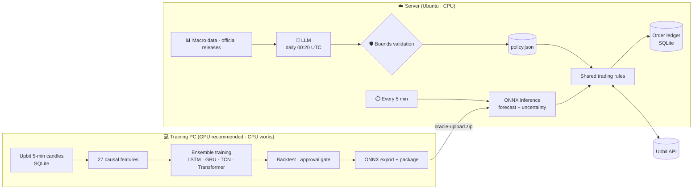
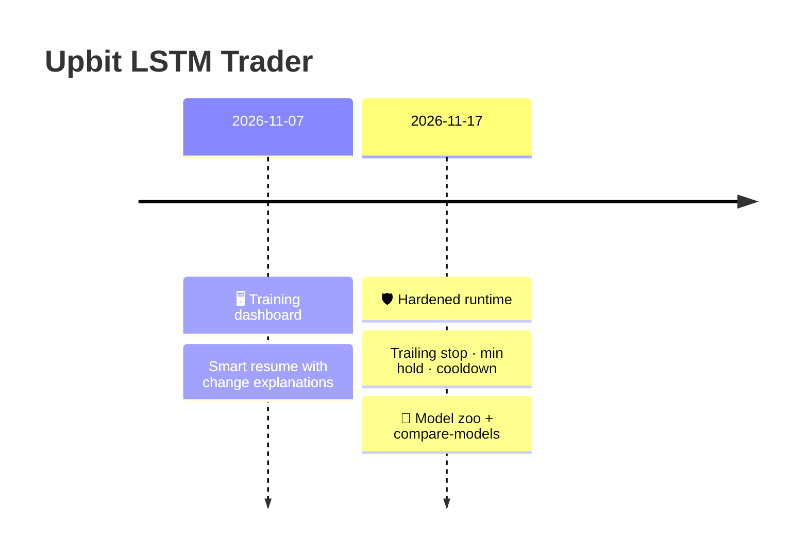

<div align="center">


<br/>

**📈 An automated spot-trading system for Upbit KRW markets: a deep-learning ensemble decides every 5 minutes,<br/>
and an 🤖 LLM reads the macro environment once a day to tighten or relax the strategy within hard limits.**

<br/>

[](https://www.python.org/)
[](https://pytorch.org/)
[](https://onnxruntime.ai/)
[](https://www.anthropic.com/)

[](https://github.com/rottenbutcher/upbit-lstm-trader/actions/workflows/test.yml)
[](https://numpy.org/)
[](https://pandas.pydata.org/)
[](https://www.sqlite.org/)
[](https://hmmlearn.readthedocs.io/)
[](https://docs.upbit.com/)
[](https://fred.stlouisfed.org/)
[](https://www.oracle.com/cloud/free/)
[](https://ubuntu.com/)
[](https://systemd.io/)
[](https://pytest.org/)
[](https://github.com/astral-sh/ruff)

<br/>

[⚡ Quick start](#-quick-start) •
[🧠 Models](#-model-zoo) •
[📐 Trading rules](#-trading-rules) •
[🤖 LLM policy](#-daily-llm-policy) •
[☁️ Deploy](#️-server-deployment) •
[🛡️ Safety](#️-safety-guards) •
[✅ Verification](#-verification) •
[🏗️ Architecture](#️-architecture) •
[📅 Timeline](#-development-timeline) •
[🗺️ Roadmap](#️-roadmap)

</div>

> [!WARNING]
> This project is for research and education. **Profits are not guaranteed and real losses can occur.**
> Paper trading is the default, no pre-trained model is included, and a model that fails the
> validation/test approval gate can never place a live buy.

---

## ✨ Highlights

| | Area | What you get |
|:-:|---|---|
| 🧠 | **Model zoo** | LSTM, GRU, TCN and patch-Transformer members, or a **heterogeneous ensemble** of all of them in one ONNX file |
| ⚖️ | **Fair comparison** | `compare-models` trains every candidate on identical data and splits and ranks them on validation only |
| 🎯 | **Trading-aware training** | 27 causal features, early stopping on **rank IC**, thresholds chosen by risk-adjusted return |
| 📐 | **One rule set** | stop-loss, trailing stop, take-profit, minimum hold, cooldown: the same code in backtest, paper and live |
| 🤖 | **Daily LLM policy** | macro data, central-bank releases and sentiment tune the strategy; code forbids any increase in risk |
| 🔁 | **Crash-safe execution** | durable order intents, identifier reconciliation, no blind resends, idempotent 5-minute cycles |
| 🖥️ | **Training dashboard** | presets, live learning curves, backtest equity, smart resume |
| ☁️ | **Low-cost operation** | train on your PC, run ONNX inference on a free CPU VM with a systemd timer and no open ports |

---

## ⚡ Quick start

**1️⃣ Train with the dashboard** (Python and libraries install themselves inside the project folder)

<table>
<tr><th>🪟 Windows</th><th>🐧 Linux</th></tr>
<tr>
<td>

```text
Double-click GUI.cmd
```

</td>
<td>

```bash
bash scripts/train.sh gui
```

</td>
</tr>
</table>

Pick a preset → adjust settings (hover for explanations) → **▶ Start training** → check the learning curves,
backtest equity and results. The output is `dist/oracle-upload.zip`. Without a GPU, CPU mode is switched on
automatically.

**2️⃣ (Optional) Pick the best architecture first**

```bash
upbit-bot compare-models --candidates lstm,gru,tcn,transformer,mixed
```

**3️⃣ Deploy** → paper trading starts automatically

```text
Double-click DEPLOY.cmd → enter the server IP and SSH key path
```

<details>
<summary>💡 <b>More commands</b> (CLI training, resume, HMM, status)</summary>

<br/>

| Task | Command |
|---|---|
| Download candles | `upbit-bot download` |
| Full training | `TRAIN.cmd` · `bash scripts/train.sh` · `upbit-bot train` |
| Resume after a stop or crash | `RESUME.cmd` · `bash scripts/train.sh resume` · `upbit-bot train --resume` |
| Compare architectures | `upbit-bot compare-models` |
| HMM comparison | `HMM.cmd` · `bash scripts/train.sh hmm` |
| Package for the server | `upbit-bot package` |
| One paper cycle | `upbit-bot run --mode paper --once` |
| Bot status | `upbit-bot status` |

</details>

> [!TIP]
> **Resuming is safe.** Epochs, ensemble size, strategy, gate and capital can change between runs. If a setting
> that defines the weights changed, the dashboard lists every change (old → new) and offers to restore it or
> start fresh. Old checkpoints are moved to `artifacts/old-checkpoints/`, never deleted.

---

## 🧠 Model zoo

Every member reads the same input (96 five-minute bars × 27 features + market one-hot) and predicts the
30-minute log return from the next bar's open. The ensemble outputs a **mean forecast** and an
**uncertainty** (member disagreement), so the server needs no PyTorch and no code change for any candidate.

| | Candidate | Structure | Strength |
|:-:|---|---|---|
| 🔁 | `lstm` | 2-layer LSTM + attention pooling | proven baseline |
| ⚡ | `gru` | GRU + attention pooling | fewer parameters, less overfitting |
| 🌊 | `tcn` | dilated causal convolutions (1–32), 253-bar receptive field | local multi-scale patterns: spikes, breakouts |
| 🔭 | `transformer` | 4-bar patches (96 → 24 tokens), pre-norm self-attention | long-range relations across the window |
| 🧬 | `mixed` | e.g. `["lstm", "tcn", "transformer"]` | diverse errors → stronger averaging and uncertainty |

```toml
[model]
architecture = ["lstm", "tcn", "transformer"]   # or a single name
ensemble = 3                                     # members cycle through the list
```

> [!NOTE]
> On 5-minute crypto returns, **deeper is not automatically better**: the signal-to-noise ratio is tiny and
> extra capacity overfits first. The project favours architectural diversity and like-for-like comparison.
> `compare-models` ranks on validation Sharpe, then validation rank IC; the test period is reported but never
> used for selection.

<details>
<summary>🔬 <b>Training & evaluation design</b></summary>

<br/>

| Item | Details |
|---|---|
| Markets | Top N KRW markets by 24 h value; stablecoins and markets without `minimum_days` of history excluded |
| Features | 27 causal rolling features: 1–288-bar returns, volatility, Parkinson range, RSI, MA gaps, volume z-scores, day/week cycles |
| Target | 30-minute log return, entry at the next candle's open |
| Training | AdamW, warmup + cosine LR, Huber loss, mixed precision on GPU, OOM-safe batch halving |
| Epoch selection | validation **rank IC** (`early_stop_metric = "ic"`); MAE tends to reward forecasts collapsing to 0 |
| Splits | train / 90-day validation / 90-day test, label windows purged at boundaries |
| Normalization | training-period statistics only |
| Threshold | chosen on validation by Sharpe (ties: profit factor) |
| Cost model | 0.05 % fee + 5 bps slippage per side |
| Export | ONNX with PyTorch ↔ ONNX parity checked at batch 1 and 5 |

A Hidden Markov Model comparison under identical conditions is in [docs/HMM.md](docs/HMM.md).

</details>

---

## 📐 Trading rules

One module (`strategy.py`) decides for the backtest, paper and live trading, so what was validated is what runs.

| | Rule | Behaviour |
|:-:|---|---|
| 🟢 | **Entry** | forecast − uncertainty penalty ≥ threshold; strongest signals are filled first |
| 🔴 | **Stop-loss** | close ≤ entry × (1 − stop) |
| 🪜 | **Trailing stop** | after a gain, close ≤ highest close × (1 − trailing) |
| 💰 | **Take-profit** | close ≥ entry × (1 + take-profit) |
| ⏳ | **Max hold** | position closed after `max_hold_bars` |
| 🧘 | **Minimum hold** | forecast-driven exits wait `min_hold_bars`; risk exits never wait |
| 🧊 | **Cooldown** | no re-entry for `cooldown_bars` after a stop or trailing exit |
| 🧯 | **Loss halts** | daily loss limit and cumulative drawdown liquidate and block buys |

---

## 🤖 Daily LLM policy

Once a day an LLM reads the market environment and proposes the next day's parameters.
**It never places orders**; only values that pass code validation are applied.

<table>
<tr>
<td width="50%" valign="top">

**📥 Inputs**

| Category | Sources |
|---|---|
| Rates & inflation | Fed funds, US 2y/10y, breakevens |
| Risk gauges | VIX, HY spread, DXY, USD/KRW |
| Official releases | Fed · ECB · SEC · BLS |
| Crypto | Fear & Greed, BTC dominance |
| Traded markets | Upbit daily trend & volatility |

</td>
<td width="50%" valign="top">

**📤 Tunable parameters**

| Parameter | Allowed range |
|---|---|
| New entries | on / off |
| Entry threshold | baseline × 0.8 – 3.0 |
| Position size · exposure | **≤ baseline only** |
| Stop-loss · daily loss limit | **≤ baseline only** |
| Take-profit · holding time | × 0.5 – 1.5 / 2.0 |
| Uncertainty penalty | 0 – 2 |

</td>
</tr>
</table>

```bash
sudo bash /opt/upbit-lstm/current/deploy/configure-llm.sh        # store API key + dry run
sudo bash /opt/upbit-lstm/current/deploy/botctl.sh policy-show   # today's parameters
```

> [!TIP]
> The LLM is optional. Without it the bot uses the validated baseline; if a call fails, trading continues and
> falls back to the baseline when the policy expires. Details: 📘 [docs/LLM_POLICY.md](docs/LLM_POLICY.md).

---

## ☁️ Server deployment

Any **Ubuntu 24.04** (ARM64 · AMD64) server works; no GPU needed. An Oracle Cloud Always Free instance is enough.

<details open>
<summary>① <b>Install · paper trading</b></summary>

<br/>

```bash
sudo apt-get update && sudo apt-get install -y unzip
mkdir -p ~/upbit-release && unzip oracle-upload.zip -d ~/upbit-release
cd ~/upbit-release && sudo bash deploy/install.sh
```

Runs 15 seconds after every 5-minute boundary:

```bash
sudo journalctl -u upbit-lstm.service -f
sudo bash /opt/upbit-lstm/current/deploy/botctl.sh status
```

</details>

<details>
<summary>② <b>Switch to live trading</b></summary>

<br/>

1. Create an [Upbit Open API](https://upbit.com/mypage/open_api_management) key with **view assets · view orders · place orders**. No withdrawal permission. Allowlist the server IP.
2. Set trading capital (default 100,000 KRW) **before training**; live trading must use the same value.
3. If the report passes the approval gate:

```bash
sudo bash /opt/upbit-lstm/current/deploy/configure-live.sh
```

Coins you already hold are never sold automatically. To hand an exact quantity to the bot:

```bash
sudo bash /opt/upbit-lstm/current/deploy/botctl.sh adopt --market KRW-BTC --quantity 0.0001 --confirm
```

</details>

<details>
<summary>③ <b>Emergency stop</b></summary>

<br/>

```bash
sudo touch /var/lib/upbit-lstm/STOP   # stop all orders
sudo bash /opt/upbit-lstm/current/deploy/botctl.sh policy-set --set allow_new_entries=false --confirm   # stop buying only
```

Recovery steps: [docs/OPERATIONS.md](docs/OPERATIONS.md).

</details>

---

## 🛡️ Safety guards

| | Area | Protection |
|:-:|---|---|
| ✅ | **Live approval** | validation and test must meet minimum trades, positive return and Sharpe, profit factor ≥ 1.05, drawdown ≤ 10 %, and 2 of 3 validation blocks profitable |
| 🗓️ | **Model freshness** | live buys blocked when training data is more than 30 days old |
| 🧯 | **Loss limits** | stop · trailing · take-profit · max hold · daily loss · cumulative drawdown (manual reset) |
| 🚪 | **Protective exits** | stop and halt sells tolerate 4× the entry spread limit, so a thin book cannot trap a position |
| 📭 | **Missing candles** | a market without its latest candle only skips entries; stops on held positions keep working |
| 🤖 | **LLM control** | cannot increase risk, daily step capped, re-validated every cycle, baseline on expiry |
| 🧾 | **Order integrity** | intent recorded before each order; uncertain outcomes reconciled by identifier, never resent |
| 📉 | **Market state** | stale candles or books, wide spreads or balance mismatches stop orders |
| 🔑 | **Secrets** | Upbit and LLM keys stored separately; data, keys and state never committed |
| 🔒 | **Model integrity** | ONNX hash, feature order and PyTorch ↔ ONNX parity verified |

> [!IMPORTANT]
> Loss limits are program checks evaluated every 5 minutes, not resting exchange orders. Sharp moves or server
> outages can push real losses beyond the limits.

<details>
<summary>⚠️ <b>Known limitations</b></summary>

<br/>

- Using today's top markets introduces **survivorship bias**.
- Historical order books and market impact cannot be reproduced; next-open fills are an approximation.
- Repeatedly tuning against the same test period invalidates it as an unseen test.
- Parameter combinations chosen by the LLM are not backtested, which is why only risk-reducing changes are allowed.
- Free cloud VMs do not guarantee uptime.

</details>

---

## ✅ Verification

<details>
<summary>🧪 <b>Show what the test suite covers</b></summary>

<br/>

- **Features:** full-history and short server-window features match; no look-ahead
- **Backtest:** next-open fills with fees, no fills on no-trade bars, strongest-signal ordering, trailing-stop exits
- **Rules:** stop beats minimum hold, cooldown after stops, legacy bundles without new keys behave as before
- **Execution:** paper never calls private APIs, same-bar idempotency, STOP file, loss-limit latching, POST timeout + restart without duplicates, partial-fill reconciliation, wide-spread skips, dust re-entry, protective sells
- **Inference:** paginated API candles, missing latest candle degrades to one market
- **Models:** every architecture trains, exports to ONNX within 0.005 bps and stays causal; end-to-end `compare-models`
- **State:** automatic migration of older ledgers
- **Policy:** clamping, step limits, expiry, prompt-injection-safe inputs
- **Resume:** safe edits resume, real changes are explained

</details>

```bash
python -m pip install torch --index-url https://download.pytorch.org/whl/cpu
python -m pip install -r requirements-runtime.txt onnx -e '.[dev,hmm]'
pytest -q && ruff check .
```

---

## 🏗️ Architecture



```text
src/upbit_bot/
├── data.py          🕯️ candle download, universe selection, gap handling
├── features.py      🧮 27 causal rolling features, splits with purging
├── model.py         🧠 LSTM · GRU · TCN · Transformer members, ensemble, ONNX export
├── model_names.py   🏷️ architecture names (no torch on the server)
├── train.py         🏋️ training, rank-IC early stopping, threshold search, report
├── compare.py       ⚖️ compare-models: same data, validation-only ranking
├── backtest.py      📊 portfolio simulation with fees and slippage
├── strategy.py      📐 shared entry / exit rules
├── runtime.py       ⏱️ 5-minute inference, risk checks, orders, reconciliation
├── state.py         🧾 durable intents and bot-owned ledger (SQLite)
├── api.py           🔌 Upbit REST client, JWT auth, GET-only retries
├── policy.py        🛡️ LLM / manual parameter bounds
├── llm_policy.py    🤖 Claude / OpenAI-compatible daily policy
├── macro.py         🌍 FRED, central-bank and regulator feeds, sentiment
├── hmm_model.py     🎲 HMM research model
├── resume.py        🔁 checkpoint identity and change explanations
└── gui.py           🖥️ training dashboard
deploy/              ☁️ systemd units, install, live and LLM setup
scripts/             🚀 Windows and Linux launchers
```

---

## 📅 Development timeline



| | Date | Milestone | What was added |
|:-:|---|---|---|
| 🖥️ | **2026-11-07** | **Dashboard** | dark training dashboard with presets, live learning curves, backtest equity, and a resume flow that names every changed setting |
| 🛡️ | **2026-11-17** | **Hardened runtime** | missing-candle and wide-spread failure modes fixed, dust re-entry, strongest-signal ordering, trailing stop, minimum hold, cooldown, stablecoin-free universe |
| 🧠 | **2026-11-17** | **Model zoo** | GRU, TCN and patch-Transformer members, heterogeneous ensembles, rank-IC early stopping, `compare-models` |

---

## 🗺️ Roadmap

- [ ] 🧾 Limit-order entries at the best bid with timeout cancel, and a fill-probability-aware backtest
- [ ] ⏱️ Longer forecast horizons (60 min+) so the edge clears round-trip costs
- [ ] 🔄 Walk-forward retraining instead of a single train / validation / test split
- [ ] 🗂️ Point-in-time universe to remove survivorship bias
- [ ] 📊 Paper-vs-backtest drift report on the server

---

## 📚 Documentation

> Detailed documents are written in Korean.

| Document | Contents |
|---|---|
| 📘 [LLM_POLICY.md](docs/LLM_POLICY.md) | data sources, bounds, operating commands |
| 🏛️ [DESIGN.md](docs/DESIGN.md) | data, training, model zoo and order design with official references |
| 🔧 [OPERATIONS.md](docs/OPERATIONS.md) | operations, failure recovery, retraining, backups |
| 📊 [HMM.md](docs/HMM.md) | HMM comparison research |
| ✅ [VERIFICATION.md](docs/VERIFICATION.md) | verification status |

<div align="center">

<br/>

**⚠️ You are solely responsible for your trading decisions. ⚠️**

⭐ **If this project helps your research, consider giving it a star!** ⭐


</div>
