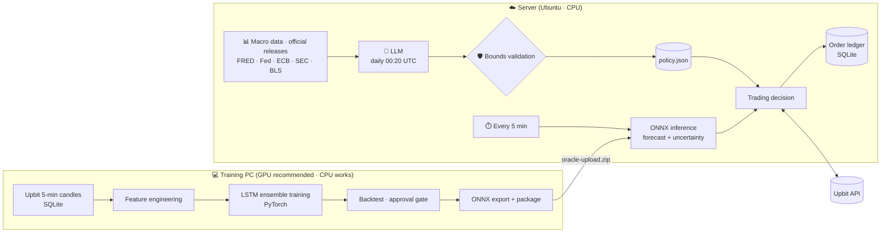

# 📈 Upbit LSTM Trader

**An automated spot-trading system for Upbit KRW markets: an LSTM ensemble forecasts every 5 minutes, and an LLM reads the market environment daily to tune the strategy.**

<br>

[](https://www.python.org/)
[](https://pytorch.org/)
[](https://onnxruntime.ai/)
[](https://www.anthropic.com/)

[](https://numpy.org/)
[](https://pandas.pydata.org/)
[](https://scikit-learn.org/)
[](https://hmmlearn.readthedocs.io/)
[](https://www.sqlite.org/)
[](https://requests.readthedocs.io/)
[](https://pyjwt.readthedocs.io/)
[](https://platform.openai.com/)
[](https://docs.python.org/3/library/tkinter.html)

[](https://docs.upbit.com/)
[](https://fred.stlouisfed.org/)
[](https://www.oracle.com/cloud/free/)
[](https://ubuntu.com/)
[](https://systemd.io/)
[](https://github.com/astral-sh/uv)

[](https://github.com/rottenbutcher/upbit-lstm-trader/actions/workflows/test.yml)
[](https://pytest.org/)
[](https://github.com/astral-sh/ruff)


<br>

[Quick Start](#-quick-start) · [Architecture](#-architecture) · [LLM Policy](#-daily-llm-policy) · [Deployment](#️-server-deployment) · [Safety](#️-safety-guards) · [Docs](#-documentation)

<br>

> [!WARNING]
> This project is for research and education. **Profits are not guaranteed and real losses can occur.** Paper trading is the default, and no pre-trained model is included in this repository.

<br>

## ✨ Features

<table>
<tr>
<td width="50%" valign="top">

### 🧠 LSTM Ensemble Forecasting
- Predicts **30-minute returns** from 5-minute candles of the top markets by trading value
- 27 causal (no look-ahead) features: short-term to 24-hour returns, volatility, volume, time-of-day and weekday cycles
- **Attention pooling** + an **ensemble** of independently seeded models
- Outputs a forecast together with its **uncertainty** (disagreement between models)

</td>
<td width="50%" valign="top">

### 🤖 Daily LLM Policy
- Reads macro indicators, central-bank and regulator releases, and market sentiment every day
- **Automatically tunes** entry threshold, position size, stop-loss / take-profit and holding time
- Code guarantees the LLM **can never take more risk than the validated limits**
- Works with Claude or any OpenAI-compatible model

</td>
</tr>
<tr>
<td width="50%" valign="top">

### 🖥️ One-Click Training GUI
- Pick a preset → save settings → train, all in one window
- Every setting is explained and validated before saving
- Live log and progress bar; resume after interruption

</td>
<td width="50%" valign="top">

### ☁️ Low-Cost Cloud Operation
- Train on your own PC, run inference on a **free cloud VM (CPU)**
- systemd timer decides every 5 minutes and recovers after reboots
- No open web ports, no withdrawal permission required

</td>
</tr>
</table>

<br>

## 🏗 Architecture



<br>

## 🚀 Quick Start

### 1️⃣ Train — GUI (recommended)

<table>
<tr><th>Windows</th><th>Linux</th></tr>
<tr>
<td>

```text
Double-click GUI.cmd
```

</td>
<td>

```bash
bash scripts/train.sh gui
```

</td>
</tr>
</table>

On first launch, Python and the training libraries are installed automatically inside the project folder. System settings are not touched.

| Step | What to do |
|:---:|---|
| **1** | Pick a preset (Quick check / Balanced (recommended) / High performance) and click **Apply** |
| **2** | Adjust values in each tab if needed, then click **Save settings** |
| **3** | Click **① Download + Train + Package** |
| **4** | When finished, click **Open report** to review the results |

The output is `dist/oracle-upload.zip`, which you upload to the server. Without a GPU, tick **CPU mode** (training takes longer).

> [!NOTE]
> The GUI labels are currently in Korean. The English names above match the buttons in order.

<details>
<summary><b>⌨️ Train from the command line</b></summary>

<br>

| Task | Windows | Linux |
|---|---|---|
| Full training | `TRAIN.cmd` | `bash scripts/train.sh` |
| Resume | `RESUME.cmd` | `bash scripts/train.sh resume` |
| HMM comparison | `HMM.cmd` | `bash scripts/train.sh hmm` |
| Environment check | — | `bash scripts/train.sh check` |

- An interrupted run resumes from the last completed epoch; finished ensemble members are skipped.
- After changing data or settings, start a fresh run.
- Back up the existing `artifacts` folder before retraining.
- To move to another PC, copy **source + `data` + `artifacts`** (not `.venv` or `.tools`).

</details>

### 2️⃣ Deploy

```text
Double-click DEPLOY.cmd → enter the server IP and SSH key path
```

Upload and installation run automatically, and **paper trading** starts. See [Server Deployment](#️-server-deployment) for details.

<br>

## 🤖 Daily LLM Policy

Once a day, an LLM analyzes the market environment and sets the next day's trading parameters. **The LLM never places orders.** It only proposes numbers, and only values that pass code validation are applied.

<table>
<tr>
<td width="50%" valign="top">

**📥 Inputs**

| Category | Sources |
|---|---|
| Rates & inflation | Fed funds rate, US 2y/10y Treasuries, breakeven inflation |
| Risk gauges | VIX, high-yield spread, dollar index, USD/KRW |
| Official releases | Fed · ECB · SEC · BLS press releases |
| Crypto | Fear & Greed index, BTC dominance |
| Traded markets | Upbit daily trend & volatility |

</td>
<td width="50%" valign="top">

**📤 Tunable parameters**

| Parameter | Allowed range |
|---|---|
| New entries | on / off |
| Entry threshold | baseline × 0.8 – 3.0 |
| Position size · total exposure | **≤ baseline only** |
| Stop-loss · daily loss limit | **≤ baseline only** |
| Take-profit · holding time | baseline × 0.5 – 1.5 / 2.0 |
| Uncertainty penalty | 0 – 2 |

</td>
</tr>
</table>

```bash
sudo bash /opt/upbit-lstm/current/deploy/configure-llm.sh        # store API key + dry run
sudo bash /opt/upbit-lstm/current/deploy/botctl.sh policy-show   # show today's parameters
```

> [!TIP]
> The LLM is optional. Without it, the bot uses the baseline values validated by training and backtesting. If the LLM call or data collection fails, trading continues and falls back to the baseline once the policy expires.

See 📘 [LLM policy documentation](docs/LLM_POLICY.md) for details.

<br>

## ☁️ Server Deployment

You need an **Ubuntu 24.04** (ARM64 · AMD64) server. No GPU is required; an Oracle Cloud Always Free instance is enough.

<details open>
<summary><b>① Install · paper trading</b></summary>

<br>

If you don't use `DEPLOY.cmd`, upload the ZIP to the server and run:

```bash
sudo apt-get update && sudo apt-get install -y unzip
mkdir -p ~/upbit-release && unzip oracle-upload.zip -d ~/upbit-release
cd ~/upbit-release && sudo bash deploy/install.sh
```

It runs 15 seconds after every 5-minute boundary. Check status with:

```bash
sudo journalctl -u upbit-lstm.service -f
sudo bash /opt/upbit-lstm/current/deploy/botctl.sh status
```

</details>

<details>
<summary><b>② Switch to live trading</b></summary>

<br>

1. Create an [Upbit Open API](https://upbit.com/mypage/open_api_management) key with **view assets · view orders · place orders** permissions. Withdrawal permission is not needed. Add the server IP to the allowlist.
2. Set trading capital (default 100,000 KRW) before training, in `config.toml` or the GUI. Live trading uses the same value.
3. If the report passes the approval gate, run:

```bash
sudo bash /opt/upbit-lstm/current/deploy/configure-live.sh
```

Coins you already hold are never sold automatically. To include them, register an exact quantity:

```bash
sudo bash /opt/upbit-lstm/current/deploy/botctl.sh adopt --market KRW-BTC --quantity 0.0001 --confirm
```

</details>

<details>
<summary><b>③ Emergency stop</b></summary>

<br>

```bash
sudo touch /var/lib/upbit-lstm/STOP   # stop all new orders
sudo bash /opt/upbit-lstm/current/deploy/botctl.sh policy-set --set allow_new_entries=false --confirm   # stop buying only
```

For recovery steps, see the [operations guide](docs/OPERATIONS.md).

</details>

<br>

## 🛡️ Safety Guards

| Area | Protection |
|---|---|
| **Live approval** | Live buys are allowed only if both validation and test periods meet minimum trades, positive return and Sharpe, profit factor ≥ 1.05 and drawdown ≤ 10% |
| **Model freshness** | New live buys are blocked when training data is more than 30 days old |
| **Loss limits** | Stop-loss · take-profit · max holding time · daily loss limit · cumulative drawdown limit (manual reset) |
| **LLM control** | Cannot increase risk, daily change is capped, falls back to baseline on expiry, re-validated every 5 minutes |
| **Order integrity** | Intent is recorded before each order with a unique identifier; uncertain responses are reconciled by lookup, never resent |
| **Market state** | Orders stop on stale candles or order books, excessive spreads, or balance mismatches |
| **Secrets** | Upbit and LLM keys are stored separately; data, keys and state are never committed to Git |
| **Model integrity** | ONNX hash, feature order and PyTorch↔ONNX numerical parity are verified |

> [!IMPORTANT]
> Loss limits are program checks evaluated every 5 minutes, not stop orders resting on the exchange. Sharp moves or server outages can push real losses beyond the limits.

<br>

## 🔬 Model Details

<details>
<summary><b>Training & evaluation design</b></summary>

<br>

| Item | Details |
|---|---|
| Markets | Top N KRW markets by trading value at first download (default 5), then fixed |
| Input | Last 96 five-minute candles (8 hours) × 27 features + market one-hot |
| Target | 30-minute log return, assuming entry at the next candle's open |
| Model | 2-layer LSTM + attention pooling, ensemble of 3 (default), Huber loss |
| Training | AdamW, warmup + cosine learning rate, early stopping, mixed precision (GPU) |
| Splits | Train / 90-day validation / 90-day test, label windows purged at boundaries |
| Normalization | Statistics from the training period only |
| Entry threshold | Chosen on validation only; the test period is used only for the final verdict |
| Cost model | 0.05% fee + 5 bps slippage per side |
| Inference | ONNX Runtime on CPU |

A Hidden Markov Model comparison under identical conditions is also available. See the [HMM documentation](docs/HMM.md).

</details>

<details>
<summary><b>⚠️ Known limitations</b></summary>

<br>

- Using today's top markets introduces **survivorship bias**.
- Historical order books and market impact cannot be reproduced; next-open fills are an approximation.
- Repeatedly tuning settings against the same test period invalidates it as an unseen test.
- Parameter combinations chosen by the LLM are not backtested, which is why only risk-reducing changes are allowed.
- Free cloud VMs do not guarantee uptime.

</details>

<br>

## 📚 Documentation

The detailed documents are currently written in Korean.

| Document | Contents |
|---|---|
| 📘 [LLM_POLICY.md](docs/LLM_POLICY.md) | LLM policy: data sources, bounds, operating commands |
| 🏛️ [DESIGN.md](docs/DESIGN.md) | Data, training and order design with official references |
| 🔧 [OPERATIONS.md](docs/OPERATIONS.md) | Operations, failure recovery, retraining, backups |
| 📊 [HMM.md](docs/HMM.md) | HMM comparison research |
| ✅ [VERIFICATION.md](docs/VERIFICATION.md) | Verification status |

<br>

## 🧑‍💻 Development

```bash
python -m pip install torch --index-url https://download.pytorch.org/whl/cpu
python -m pip install -r requirements-runtime.txt onnx -e '.[dev,hmm]'
pytest -q && ruff check .
```

<details>
<summary><b>📁 Project structure</b></summary>

<br>

```text
src/upbit_bot/
├── data.py · features.py      # data collection · causal features
├── model.py · train.py        # LSTM ensemble training · ONNX export
├── backtest.py · strategy.py  # backtest · shared trading rules
├── runtime.py · state.py      # 5-minute inference · order ledger
├── macro.py · llm_policy.py   # macro data · LLM call
├── policy.py                  # parameter bounds validation
├── gui.py                     # training GUI
└── hmm_model.py · hmm_research.py
deploy/                        # systemd units · install · key setup scripts
scripts/                       # Windows · Linux training launchers
```

</details>

<br>

<div align="center">

**⚠️ You are solely responsible for your trading decisions ⚠️**

<sub>Built with PyTorch · ONNX Runtime · Claude · Upbit Open API</sub>

</div>
